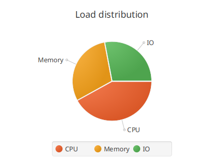
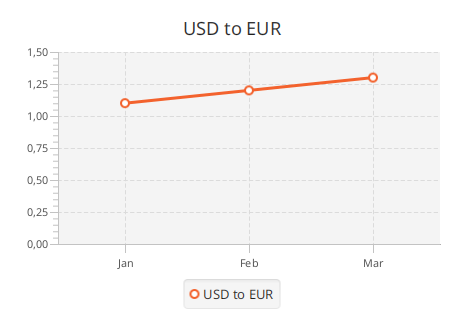
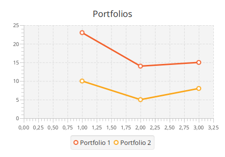

# Charts

TornadoFX provides builders for the standard JavaFX chart types, so charts are
declared instead of assembled. All builders live in `tornadofx.*` and wrap the
corresponding `javafx.scene.chart` classes — anything beyond what is shown
here (styling, lookups, animations) is plain JavaFX API.

## PieChart

`piechart` takes an optional title and adds data declaratively with `data`:

```kotlin
piechart("Load distribution") {
    data("CPU", 42.0)
    data("Memory", 30.0)
    data("IO", 28.0)
}
```

There is also a map shortcut, and each `data` entry accepts a configuration
block — a convenient place to attach handlers to the slice node:

```kotlin
piechart("Load distribution") {
    data(mapOf("CPU" to 42.0, "Memory" to 30.0, "IO" to 28.0))
    data("Other", 5.0) {
        node.setOnMouseClicked { println("$name clicked") }
    }
}
```



## XY charts

The XY chart builders (`linechart`, `areachart`, `barchart`,
`stackedbarchart`, `scatterchart`, `bubblechart`) take the two axes plus an
optional title. Series and data points are added inside the builder:

```kotlin
linechart("USD to EUR", CategoryAxis(), NumberAxis()) {
    series("USD to EUR") {
        data("Jan", 1.1)
        data("Feb", 1.2)
        data("Mar", 1.3)
    }
}
```



Axes are configured like any other node — pass pre-configured instances or
adjust them in the chart block:

```kotlin
barchart("Sales", CategoryAxis(), NumberAxis(0.0, 100.0, 10.0)) {
    series("2025") {
        data("Q1", 31.5)
        data("Q2", 45.0)
        data("Q3", 24.0)
    }
}
```

## Multiple series at once

`multiseries` creates several series and lets you append one x value with a y
value per series in a single call:

```kotlin
linechart("Portfolios", NumberAxis(), NumberAxis()) {
    multiseries("Portfolio 1", "Portfolio 2") {
        data(1, 23, 10)
        data(2, 14, 5)
        data(3, 15, 8)
    }
}
```



Live updates work as everywhere in JavaFX: the series hold observable data
lists, so appending `data(...)` to a series already shown in a chart updates
the chart.
