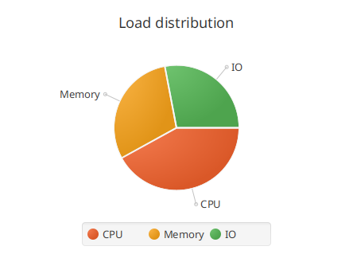
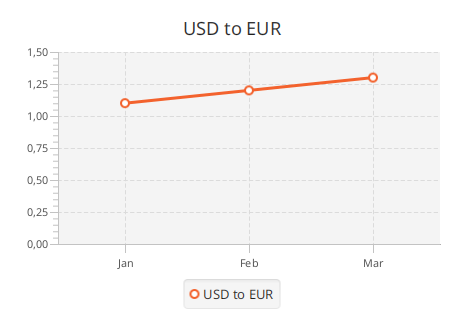
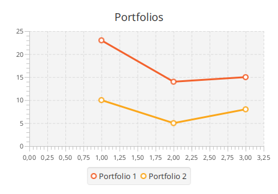

# Диаграммы

TornadoFX предоставляет билдеры для стандартных типов диаграмм JavaFX, поэтому
диаграммы декларируются, а не собираются вручную. Все билдеры живут в
`tornadofx.*` и оборачивают соответствующие классы `javafx.scene.chart` — всё,
что не показано здесь (стилизация, lookups, анимации), остается обычным API
JavaFX.

## PieChart

`piechart` принимает опциональный заголовок, а данные добавляются
декларативно через `data`:

```kotlin
piechart("Load distribution") {
    data("CPU", 42.0)
    data("Memory", 30.0)
    data("IO", 28.0)
}
```

Есть и краткая форма с картой, а каждая запись `data` принимает блок
конфигурации — удобное место, чтобы повесить обработчики на ноду сектора:

```kotlin
piechart("Load distribution") {
    data(mapOf("CPU" to 42.0, "Memory" to 30.0, "IO" to 28.0))
    data("Other", 5.0) {
        node.setOnMouseClicked { println("$name clicked") }
    }
}
```



## XY-диаграммы

Билдеры XY-диаграмм (`linechart`, `areachart`, `barchart`, `stackedbarchart`,
`scatterchart`, `bubblechart`) принимают две оси и опциональный заголовок.
Серии и точки данных добавляются внутри билдера:

```kotlin
linechart("USD to EUR", CategoryAxis(), NumberAxis()) {
    series("USD to EUR") {
        data("Jan", 1.1)
        data("Feb", 1.2)
        data("Mar", 1.3)
    }
}
```



Оси настраиваются как любой другой нод — передавайте готовые экземпляры или
настраивайте их в блоке диаграммы:

```kotlin
barchart("Sales", CategoryAxis(), NumberAxis(0.0, 100.0, 10.0)) {
    series("2025") {
        data("Q1", 31.5)
        data("Q2", 45.0)
        data("Q3", 24.0)
    }
}
```

## Несколько серий сразу

`multiseries` создает несколько серий и позволяет одним вызовом добавить одно
значение x со значением y для каждой серии:

```kotlin
linechart("Portfolios", NumberAxis(), NumberAxis()) {
    multiseries("Portfolio 1", "Portfolio 2") {
        data(1, 23, 10)
        data(2, 14, 5)
        data(3, 15, 8)
    }
}
```



Живые обновления работают как везде в JavaFX: серии хранят observable-списки
данных, поэтому добавление `data(...)` в уже показанную серию сразу обновляет
диаграмму.
