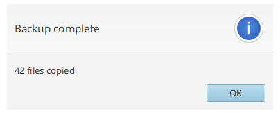
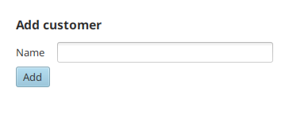
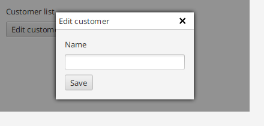

# Dialogs & windows

TornadoFX wraps JavaFX alerts and choosers in short functions, adds a `dialog`
builder, and can host views in internal windows drawn over the current view.

## Alerts and confirmations

`alert` shows a dialog of the given type; the clicked button is passed to the
trailing function. Shortcuts exist for the common types:

```kotlin
alert(Alert.AlertType.INFORMATION, "Backup complete", "42 files copied") {
    println("Closed with $it")
}

information("Backup complete", "42 files copied")
warning("Disk almost full", "Only 2 GB left")
error("Upload failed", "The server rejected the file")
```



`confirmation` returns the choice through the button parameter, and `confirm`
runs an action only when the confirm button is clicked:

```kotlin
confirmation("Save changes?") {
    if (it == ButtonType.OK) save()
}

confirm("Delete file", "This cannot be undone") {
    deleteFile()
}
```

All of these accept custom `ButtonType`s, an `owner` window and a `title`.

## File and directory choosers

`chooseFile` opens a native chooser; the mode decides between open, multi
select and save. Extension filters restrict the visible files. The call blocks
and returns an empty list when the user cancels:

```kotlin
val images = chooseFile(
    "Select images",
    arrayOf(FileChooser.ExtensionFilter("Images", "*.png", "*.jpg")),
    mode = FileChooserMode.Multi
)

val target = chooseFile(
    "Export report",
    arrayOf(FileChooser.ExtensionFilter("PDF", "*.pdf")),
    mode = FileChooserMode.Save
).firstOrNull()
```

`chooseDirectory` picks a folder and returns the `File` or `null`:

```kotlin
val folder = chooseDirectory("Select output folder")
```

## The dialog builder

`dialog` opens a modal form dialog. Inside, it behaves like a form — `field`
declares labeled inputs, and `close()` closes the dialog from any action:

```kotlin
dialog("Add customer") {
    val nameInput = textfield()
    field("Name") { this += nameInput }
    button("Add") {
        isDefaultButton = true
        setOnAction {
            customers.add(Customer(nameInput.text))
            close()
        }
    }
}
```



The builder returns the dialog `Stage`, so it can also be closed from the
outside.

## Internal windows

`openInternalWindow` shows a view inside a draggable window drawn over the
current view — no separate `Stage` involved. The window is closed by its close
button, or by Escape when `escapeClosesWindow` is on:

```kotlin
button("Edit customer") {
    setOnAction {
        openInternalWindow<CustomerEditor>()
    }
}
```



The call accepts injection `params`, a custom `icon`, and flags for modality
and movement. For one-off content there is `openInternalBuilderWindow`, which
builds the window content inline:

```kotlin
openInternalBuilderWindow("Quick help") {
    stackpane {
        label("Press Escape to close")
    }
}
```

## Separate windows and modality

`openWindow` (alias `openModal`) shows this view in a real `Stage` with
configurable modality and style; `closeModal` closes it again:

```kotlin
class AboutView : View("About") {
    override val root = stackpane { label("TornadoFX 2.x") }
}

// from any view or fragment:
openWindow(stageStyle = StageStyle.UTILITY, modality = Modality.NONE)
closeModal()
```

## Decorations

Decorators attach transient visuals to a node — the validation support uses
this to mark invalid fields. A `Decorator` implements `decorate`/`undecorate`
and is attached with `addDecorator`:

```kotlin
class HighlightDecorator : Decorator {
    override fun decorate(node: Node) {
        node.addClass("highlighted")
    }

    override fun undecorate(node: Node) {
        node.removeClass("highlighted")
    }
}

inputField.addDecorator(HighlightDecorator())
inputField.removeDecorator(HighlightDecorator())
```
