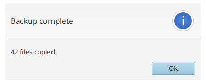
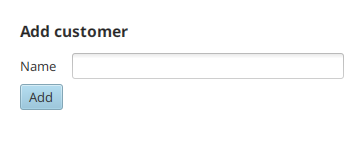
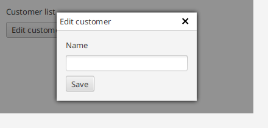

# Диалоги и окна

TornadoFX оборачивает алерты и чузеры JavaFX в короткие функции, добавляет
билдер `dialog` и умеет показывать вью во внутренних окнах поверх текущего
вью.

## Алерты и подтверждения

`alert` показывает диалог заданного типа; нажатая кнопка передается в
замыкание. Для распространенных типов есть короткие функции:

```kotlin
alert(Alert.AlertType.INFORMATION, "Backup complete", "42 files copied") {
    println("Closed with $it")
}

information("Backup complete", "42 files copied")
warning("Disk almost full", "Only 2 GB left")
error("Upload failed", "The server rejected the file")
```



`confirmation` возвращает выбор через параметр-кнопку, а `confirm` выполняет
действие только при нажатии кнопки подтверждения:

```kotlin
confirmation("Save changes?") {
    if (it == ButtonType.OK) save()
}

confirm("Delete file", "This cannot be undone") {
    deleteFile()
}
```

Все они принимают свои `ButtonType`, окно-владелец `owner` и `title`.

## Выбор файлов и каталогов

`chooseFile` открывает нативный чузер; режим решает, открывать, выбирать
несколько или сохранять. Extension-фильтры ограничивают видимые файлы. Вызов
блокирует и возвращает пустой список при отмене:

```kotlin
val images = chooseFile(
    "Select images",
    arrayOf(FileChooser.ExtensionFilter("Images", "*.png", "*.jpg")),
    mode = FileChooserMode.Multi
)

val target = chooseFile(
    "Export report",
    arrayOf(FileChooser.ExtensionFilter("PDF", "*.pdf")),
    mode = FileChooserMode.Save
).firstOrNull()
```

`chooseDirectory` выбирает папку и возвращает `File` или `null`:

```kotlin
val folder = chooseDirectory("Select output folder")
```

## Билдер dialog

`dialog` открывает модальный диалог-форму. Внутри он ведет себя как форма —
`field` объявляет подписанные поля ввода, а `close()` закрывает диалог из
любого действия:

```kotlin
dialog("Add customer") {
    val nameInput = textfield()
    field("Name") { this += nameInput }
    button("Add") {
        isDefaultButton = true
        setOnAction {
            customers.add(Customer(nameInput.text))
            close()
        }
    }
}
```



Билдер возвращает `Stage` диалога, поэтому его можно закрыть и снаружи.

## Внутренние окна

`openInternalWindow` показывает вью в перетаскиваемом окне, отрисованном
поверх текущего вью — без отдельного `Stage`. Окно закрывается кнопкой с
крестиком или Escape, когда включен `escapeClosesWindow`:

```kotlin
button("Edit customer") {
    setOnAction {
        openInternalWindow<CustomerEditor>()
    }
}
```



Вызов принимает параметры внедрения `params`, свою `icon` и флаги модальности
и перемещения. Для разового содержимого есть `openInternalBuilderWindow`,
который строит содержимое окна инлайн:

```kotlin
openInternalBuilderWindow("Quick help") {
    stackpane {
        label("Press Escape to close")
    }
}
```

## Отдельные окна и модальность

`openWindow` (алиас `openModal`) показывает это вью в настоящем `Stage` с
настраиваемой модальностью и стилем; `closeModal` закрывает его обратно:

```kotlin
class AboutView : View("About") {
    override val root = stackpane { label("TornadoFX 2.x") }
}

// из любого вью или фрагмента:
openWindow(stageStyle = StageStyle.UTILITY, modality = Modality.NONE)
closeModal()
```

## Декорации

Декораторы крепят к ноде временные визуальные элементы — так поддержка
валидации помечает невалидные поля. `Decorator` реализует
`decorate`/`undecorate` и подключается через `addDecorator`:

```kotlin
class HighlightDecorator : Decorator {
    override fun decorate(node: Node) {
        node.addClass("highlighted")
    }

    override fun undecorate(node: Node) {
        node.removeClass("highlighted")
    }
}

inputField.addDecorator(HighlightDecorator())
inputField.removeDecorator(HighlightDecorator())
```
