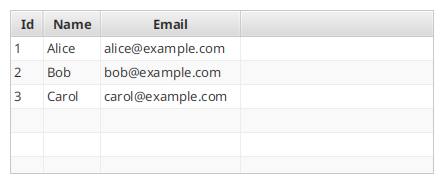
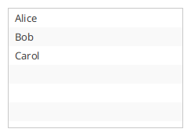
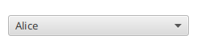
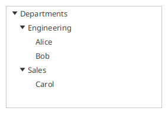
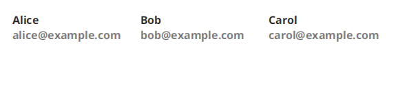

# Items & controls

TornadoFX adds builders and helpers for the controls that show collections of
items: `TableView`, `ListView`, `ComboBox`, `TreeView` and `DataGrid`. This page
covers the common surface — columns and cells, the table edit model, selection
binding and autocompletion. The long tail of overloads lives in the KDoc of the
corresponding source files.

The examples below assume this domain class, which pairs JavaFX properties
with delegated accessors — the idiomatic TornadoFX entity style. The delegated
properties are declared nullable, which is exactly what the column editors
expect:

```kotlin
class Person(id: Int, name: String, email: String, active: Boolean = true) {
    val idProperty = SimpleIntegerProperty(id)
    val nameProperty = SimpleStringProperty(name)
    val emailProperty = SimpleStringProperty(email)
    val activeProperty = SimpleBooleanProperty(active)

    var id: Int? by idProperty
    var name: String? by nameProperty
    var email: String? by emailProperty
    var active: Boolean? by activeProperty
}
```

## TableView

### Building a table and columns

`tableview` takes an `ObservableList`. Columns are declared inside the builder:

```kotlin
tableview<Person> {
    items = observableListOf(
        Person(1, "Alice", "alice@example.com"),
        Person(2, "Bob", "bob@example.com")
    )
    column("Id", Person::id)
    column("Name", Person::name)
    column("Email", Person::email)
}
```



Column overloads, by the kind of property you point them at:

- `column("Name", Person::name)` — a mutable Kotlin property (`var`), kept live
  through the property.
- `readonlyColumn("Id", Person::id)` — a read-only Kotlin property (`val`).
- `column<Person, String>("Name", "name")` — a property name string; the
  reflection-based fallback, also the way to read Java beans.
- `column<Person, String>("Name", String::class) { value { it.value.name } }` —
  a custom value factory; the returned value is wrapped in an observable
  automatically if it is not one.
- `column("Person") { SimpleObjectProperty(it.value) }` — a column over any
  `ObservableValue`.

Other column helpers:

```kotlin
tableview<Person> {
    makeIndexColumn()                       // auto-numbered "#" column
    column("Name", Person::name)
    column("Email", Person::email).enableTextWrap()
    nestedColumn("Contact") {               // column group
        column("Email", Person::email)
    }
}
```

### Cell rendering with cellFormat and cellCache

`cellFormat` configures every cell that displays an item; the receiver is the
`TableCell` and the parameter is the item:

```kotlin
column("Email", Person::email).cellFormat {
    text = item
    style = if (item?.endsWith("@example.com") == true) "" else "-fx-text-fill: red;"
}
```

`cellCache` builds a node once per item and reuses it as the cell graphic —
use it when the cell content is a real builder layout, since it is expensive
to recreate while scrolling. Here the column carries the whole `Person`:

```kotlin
column("Person") { SimpleObjectProperty(it.value) }.cellCache {
    vbox {
        label(it.name ?: "-")
        label(it.email ?: "-") { addClass("muted") }
    }
}
```

### The edit model

Make the table editable and choose an editing control per column:

```kotlin
tableview<Person> {
    items = people
    enableCellEditing()
    column("Name", Person::name).useTextField()
    column("Email", Person::email).useTextField()
    column("Active", Person::active).useCheckbox()
}
```

Available editors: `useTextField()` (a converter is required for non-`String`
columns), `useComboBox(items)`, `useChoiceBox(items)`, `useCheckbox()` and
`useProgressBar(scope)`.

Instead of handling edits per column you can react once, for the whole table.
Inside the handlers the edit event is the receiver and the row item comes as
parameter; edits can be vetoed with `cancel()`:

```kotlin
tableview<Person> {
    enableCellEditing()
    column("Name", Person::name).useTextField()
    onEditStart { person ->
        if (person.id == 0) cancel()  // rows without an id are not editable
    }
    onEditCommit { person ->
        save(person)
    }
}
```

For change tracking, `enableDirtyTracking()` records the original value of
every edited column and draws a dirty marker; the edit model can commit or
roll back:

```kotlin
val table = tableview<Person> {
    enableCellEditing()
    column("Name", Person::name).useTextField()
    enableDirtyTracking()
}
val model = table.editModel
model.selectedItemDirty.onChange { saveButton.isDisable = !it }
model.commitSelected()   // or model.rollbackSelected()
```

### Selection and item events

`bindSelected` pushes the selected row into a property or an
`ItemViewModel`, keeping the rest of the UI in sync with the table:

```kotlin
class PersonModel : ItemViewModel<Person>() {
    val name = bind(Person::nameProperty)
    val email = bind(Person::emailProperty)
}

class PersonList : View() {
    val model: PersonModel by inject()
    val table = tableview<Person> {
        column("Name", Person::name)
        column("Email", Person::email)
        bindSelected(model)
    }
    override val root = vbox { this += table }
}
```

Item events work the same way as on `ListView`: `onUserSelect` fires on
double-click (or N clicks / Enter), `onUserDelete` on Backspace, and
`asyncItems` loads items off the UI thread:

```kotlin
tableview<Person> {
    asyncItems { fetchPeopleFromServer() }
    onUserSelect { person -> openEditor(person) }
    onUserDelete { person -> confirmDelete(person) }
    multiSelect()
    selectOnDrag()
}
```

Selection can also be driven programmatically with
`selectWhere { it.active == true }`, and rows can host extra content via
`rowExpander`:

```kotlin
tableview<Person> {
    column("Name", Person::name)
    rowExpander(expandOnDoubleClick = true) {
        padding = Insets(10.0)
        label("Details for ${it.name}")
    }
}
```

## ListView

`listview` binds to an `ObservableList` and shares the cell/event helpers of
the table:

```kotlin
val names = observableListOf("Alice", "Bob", "Carol")

listview(names) {
    cellFormat { text = item }
    onUserSelect { name -> openDetails(name) }
    onUserDelete { name -> names.remove(name) }
    asyncItems { loadNamesAsync() }
    bindSelected(selectedNameProperty)
}
```



`cellCache` caches the graphic per item exactly like the table version, and
`multiSelect()` enables multiple selection. Editable lists install edit
support with `onEdit`, which receives an `EditEventType`
(`StartEdit`, `CommitEdit`, `CancelEdit`) while the edited cell is the
receiver:

```kotlin
listview(names) {
    isEditable = true
    onEdit { eventType, newValue ->
        if (eventType == EditEventType.CommitEdit)
            names[index] = newValue ?: item
    }
}
```

## ComboBox

`combobox` optionally binds a property and a list of values:

```kotlin
val selectedPerson = objectProperty<Person>()

combobox(selectedPerson, people) {
    cellFormat { text = it.name }
}
```



`bindSelected` writes the chosen item into a property one-way, while passing a
property to the builder keeps the value two-way bound (`bind`). A model
property works as well:

```kotlin
combobox<Person>().bindSelected(model.itemProperty)
```

### Autocompletion

`makeAutocompletable()` turns the combo box into a type-to-filter control with
an automatically sized popup. Supply a filter to control the matching:

```kotlin
combobox(selectedPerson, people).makeAutocompletable { query ->
    people.filter { it.name?.contains(query, ignoreCase = true) == true }
}
```

## TreeView

`treeview` takes a root `TreeItem`; `treeitem` declares children
declaratively:

```kotlin
treeview<String>(TreeItem("Departments")) {
    root.treeitem("Engineering") {
        treeitem("Alice")
        treeitem("Bob")
    }
    root.treeitem("Sales") {
        treeitem("Carol")
    }
    root.expandAll()
}
```



`populate` builds the tree from an existing object graph — the child factory
returns the children of whatever item it is given:

```kotlin
treeview<File>(TreeItem(File("/home"))).apply {
    populate { parent -> (parent.value as File).listFiles()?.toList() }
}
```

`lazyPopulate` defers each level until the node is expanded, which suits
slow sources like a filesystem or a remote API:

```kotlin
treeview<File>(TreeItem(File("/"))).apply {
    lazyPopulate(childFactory = { parent ->
        (parent.value as File).listFiles()?.toList()
    })
}
```

Selection helpers mirror the other controls — `bindSelected(model)` extracts
the `TreeItem` value, `onUserSelect`, `onUserDelete` and `selectedValue`
operate on values, not nodes, and `cellFormat`/`cellDecorator` style the
cells:

```kotlin
treeview<File>(TreeItem(File("/home"))).apply {
    populate { it.value.listFiles()?.toList() }
    cellFormat { text = it.name }
    bindSelected(selectedFileProperty)
    onUserDelete { file -> confirmDelete(file) }
}
```

`TreeItem` helpers: `expandTo(depth)`, `expandAll()` and `collapseAll()`.

## DataGrid

`DataGrid` shows items as a grid of fixed-size cells:

```kotlin
datagrid(people) {
    cellWidth = 120.0
    cellHeight = 120.0
    maxCellsInRow = 4
    cellFormat {
        graphic = cache {
            vbox {
                label(it.name ?: "-")
                label(it.email ?: "-") { addClass("muted") }
            }
        }
    }
    onUserSelect(2) { person -> openEditor(person) }
}
```



`cellCache` works here too, and `cellFragment<PersonFragment>()` hands the
cell to a `DataGridCellFragment` when the content needs its own controller.
`DataGridPaginator` pages a large source list and doubles as a page button
row:

```kotlin
vbox {
    val paginator = DataGridPaginator(people, itemsPerPage = 12)
    datagrid(paginator.items) {
        cellFormat { text = item.name }
    }
    this += paginator
}
```
