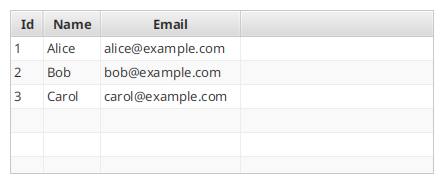
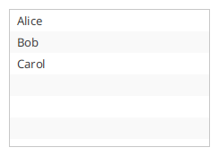
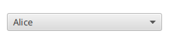
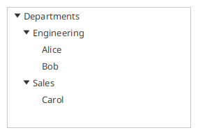
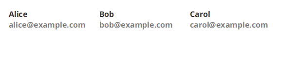

# Элементы и контролы

TornadoFX добавляет билдеры и хелперы для контролов, показывающих коллекции
элементов: `TableView`, `ListView`, `ComboBox`, `TreeView` и `DataGrid`. Эта
страница описывает основную поверхность — колонки и ячейки, модель редактирования
таблицы, привязку выделения и автодополнение. Длинный хвост перегрузок описан
в KDoc соответствующих исходных файлов.

В примерах ниже используется этот доменный класс, который соединяет
JavaFX-свойства с делегированным доступом — идиоматичный стиль сущностей в
TornadoFX. Делегированные свойства объявлены nullable — именно этого ждут
редакторы колонок:

```kotlin
class Person(id: Int, name: String, email: String, active: Boolean = true) {
    val idProperty = SimpleIntegerProperty(id)
    val nameProperty = SimpleStringProperty(name)
    val emailProperty = SimpleStringProperty(email)
    val activeProperty = SimpleBooleanProperty(active)

    var id: Int? by idProperty
    var name: String? by nameProperty
    var email: String? by emailProperty
    var active: Boolean? by activeProperty
}
```

## TableView

### Построение таблицы и колонок

`tableview` принимает `ObservableList`. Колонки объявляются внутри билдера:

```kotlin
tableview<Person> {
    items = observableListOf(
        Person(1, "Alice", "alice@example.com"),
        Person(2, "Bob", "bob@example.com")
    )
    column("Id", Person::id)
    column("Name", Person::name)
    column("Email", Person::email)
}
```



Перегрузки `column` — по типу свойства, на которое они указывают:

- `column("Name", Person::name)` — изменяемое Kotlin-свойство (`var`), значение
  остаётся живым через свойство.
- `readonlyColumn("Id", Person::id)` — свойство только для чтения (`val`).
- `column<Person, String>("Name", "name")` — имя свойства строкой; резерв через
  рефлексию, а также способ читать Java-бины.
- `column<Person, String>("Name", String::class) { value { it.value.name } }` —
  своя фабрика значений; не-observable результат автоматически заворачивается
  в observable.
- `column("Person") { SimpleObjectProperty(it.value) }` — колонка над любым
  `ObservableValue`.

Прочие хелперы колонок:

```kotlin
tableview<Person> {
    makeIndexColumn()                       // нумерованная колонка "#"
    column("Name", Person::name)
    column("Email", Person::email).enableTextWrap()
    nestedColumn("Contact") {               // группа колонок
        column("Email", Person::email)
    }
}
```

### Отрисовка ячеек: cellFormat и cellCache

`cellFormat` настраивает каждую ячейку, показывающую элемент; ресивер — это
`TableCell`, параметр — элемент:

```kotlin
column("Email", Person::email).cellFormat {
    text = item
    style = if (item?.endsWith("@example.com") == true) "" else "-fx-text-fill: red;"
}
```

`cellCache` строит ноду один раз на элемент и переиспользует её как графину
ячейки — используйте его, когда содержимое ячейки — настоящий layout из
билдера, поскольку пересоздавать его при прокрутке дорого. Здесь колонка несёт
весь объект `Person`:

```kotlin
column("Person") { SimpleObjectProperty(it.value) }.cellCache {
    vbox {
        label(it.name ?: "-")
        label(it.email ?: "-") { addClass("muted") }
    }
}
```

### Модель редактирования

Сделайте таблицу редактируемой и выберите контрол редактирования для каждой
колонки:

```kotlin
tableview<Person> {
    items = people
    enableCellEditing()
    column("Name", Person::name).useTextField()
    column("Email", Person::email).useTextField()
    column("Active", Person::active).useCheckbox()
}
```

Доступные редакторы: `useTextField()` (для не-`String` колонок нужен
конвертер), `useComboBox(items)`, `useChoiceBox(items)`, `useCheckbox()` и
`useProgressBar(scope)`.

Вместо обработки правок по каждой колонке можно отреагировать один раз на всю
таблицу. Внутри хендлеров событие правки — это ресивер, а строка-элемент
приходит параметром; правку можно отменить через `cancel()`:

```kotlin
tableview<Person> {
    enableCellEditing()
    column("Name", Person::name).useTextField()
    onEditStart { person ->
        if (person.id == 0) cancel()  // строки без id не редактируются
    }
    onEditCommit { person ->
        save(person)
    }
}
```

Для отслеживания изменений `enableDirtyTracking()` запоминает исходное
значение каждой отредактированной колонки и рисует маркер «грязности»;
модель редактирования умеет фиксировать или откатывать правки:

```kotlin
val table = tableview<Person> {
    enableCellEditing()
    column("Name", Person::name).useTextField()
    enableDirtyTracking()
}
val model = table.editModel
model.selectedItemDirty.onChange { saveButton.isDisable = !it }
model.commitSelected()   // или model.rollbackSelected()
```

### Выделение и события элементов

`bindSelected` отправляет выделенную строку в свойство или `ItemViewModel`,
удерживая остальной UI в синхроне с таблицей:

```kotlin
class PersonModel : ItemViewModel<Person>() {
    val name = bind(Person::nameProperty)
    val email = bind(Person::emailProperty)
}

class PersonList : View() {
    val model: PersonModel by inject()
    val table = tableview<Person> {
        column("Name", Person::name)
        column("Email", Person::email)
        bindSelected(model)
    }
    override val root = vbox { this += table }
}
```

События элементов работают так же, как у `ListView`: `onUserSelect` срабатывает
по двойному клику (или N кликов / Enter), `onUserDelete` — по Backspace,
а `asyncItems` загружает элементы вне UI-потока:

```kotlin
tableview<Person> {
    asyncItems { fetchPeopleFromServer() }
    onUserSelect { person -> openEditor(person) }
    onUserDelete { person -> confirmDelete(person) }
    multiSelect()
    selectOnDrag()
}
```

Выделением можно управлять и программно — через `selectWhere { it.active == true }`,
а в строках можно размещать дополнительный контент через `rowExpander`:

```kotlin
tableview<Person> {
    column("Name", Person::name)
    rowExpander(expandOnDoubleClick = true) {
        padding = Insets(10.0)
        label("Details for ${it.name}")
    }
}
```

## ListView

`listview` привязывается к `ObservableList` и разделяет хелперы ячеек и
событий с таблицей:

```kotlin
val names = observableListOf("Alice", "Bob", "Carol")

listview(names) {
    cellFormat { text = item }
    onUserSelect { name -> openDetails(name) }
    onUserDelete { name -> names.remove(name) }
    asyncItems { loadNamesAsync() }
    bindSelected(selectedNameProperty)
}
```



`cellCache` кэширует графину на элемент точно так же, как в таблице, а
`multiSelect()` включает множественное выделение. Редактируемые списки
устанавливают поддержку правок через `onEdit`, который получает
`EditEventType` (`StartEdit`, `CommitEdit`, `CancelEdit`), а редактируемая
ячейка — это ресивер:

```kotlin
listview(names) {
    isEditable = true
    onEdit { eventType, newValue ->
        if (eventType == EditEventType.CommitEdit)
            names[index] = newValue ?: item
    }
}
```

## ComboBox

`combobox` опционально привязывает свойство и список значений:

```kotlin
val selectedPerson = objectProperty<Person>()

combobox(selectedPerson, people) {
    cellFormat { text = it.name }
}
```



`bindSelected` записывает выбранный элемент в свойство в одну сторону, а
передача свойства в билдер держит значение двунаправленной привязкой
(`bind`). Свойство модели тоже подходит:

```kotlin
combobox<Person>().bindSelected(model.itemProperty)
```

### Автодополнение

`makeAutocompletable()` превращает комбобокс в контрол с фильтрацией по вводу
и автоматически подстраивающимся попапом. Передайте свой фильтр, чтобы
управлять сопоставлением:

```kotlin
combobox(selectedPerson, people).makeAutocompletable { query ->
    people.filter { it.name?.contains(query, ignoreCase = true) == true }
}
```

## TreeView

`treeview` принимает корневой `TreeItem`; `treeitem` объявляет детей
декларативно:

```kotlin
treeview<String>(TreeItem("Departments")) {
    root.treeitem("Engineering") {
        treeitem("Alice")
        treeitem("Bob")
    }
    root.treeitem("Sales") {
        treeitem("Carol")
    }
    root.expandAll()
}
```



`populate` строит дерево из готового графа объектов — фабрика детей возвращает
детей того элемента, который получила:

```kotlin
treeview<File>(TreeItem(File("/home"))).apply {
    populate { parent -> (parent.value as File).listFiles()?.toList() }
}
```

`lazyPopulate` откладывает каждый уровень до раскрытия ноды, что подходит для
медленных источников вроде файловой системы или удалённого API:

```kotlin
treeview<File>(TreeItem(File("/"))).apply {
    lazyPopulate(childFactory = { parent ->
        (parent.value as File).listFiles()?.toList()
    })
}
```

Хелперы выделения повторяют остальные контролы — `bindSelected(model)`
извлекает значение `TreeItem`, `onUserSelect`, `onUserDelete` и `selectedValue`
работают со значениями, а не нодами, а `cellFormat`/`cellDecorator` стилизуют
ячейки:

```kotlin
treeview<File>(TreeItem(File("/home"))).apply {
    populate { it.value.listFiles()?.toList() }
    cellFormat { text = it.name }
    bindSelected(selectedFileProperty)
    onUserDelete { file -> confirmDelete(file) }
}
```

Хелперы `TreeItem`: `expandTo(depth)`, `expandAll()` и `collapseAll()`.

## DataGrid

`DataGrid` показывает элементы в виде сетки ячеек фиксированного размера:

```kotlin
datagrid(people) {
    cellWidth = 120.0
    cellHeight = 120.0
    maxCellsInRow = 4
    cellFormat {
        graphic = cache {
            vbox {
                label(it.name ?: "-")
                label(it.email ?: "-") { addClass("muted") }
            }
        }
    }
    onUserSelect(2) { person -> openEditor(person) }
}
```



Здесь работает и `cellCache`, а `cellFragment<PersonFragment>()` передает
ячейку в `DataGridCellFragment`, когда содержимому нужен свой контроллер.
`DataGridPaginator` разбивает большой список на страницы и заодно служит
строкой кнопок страниц:

```kotlin
vbox {
    val paginator = DataGridPaginator(people, itemsPerPage = 12)
    datagrid(paginator.items) {
        cellFormat { text = item.name }
    }
    this += paginator
}
```
